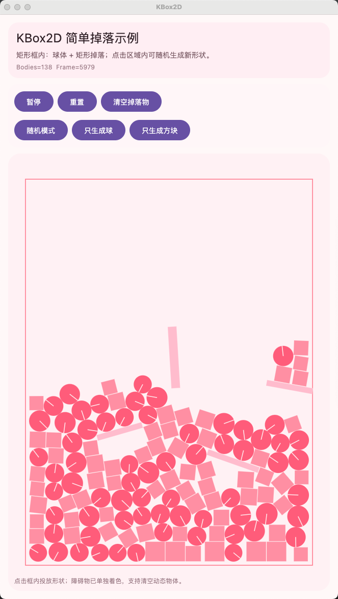

# KBox2D

[English](README.md) | **简体中文**

KBox2D 是一个基于 Kotlin Multiplatform 的 2D 物理引擎实验项目，用来把 JBox2D / Box2D 的核心能力迁移到 Kotlin 多平台环境，并通过 Compose Multiplatform 提供可运行演示。



## 这个仓库里有什么

- [`kbox2d/`](kbox2d/)：物理引擎核心模块
- [`composeApp/`](composeApp/)：Compose 多平台演示应用
- [`iosApp/`](iosApp/)：iOS 容器工程
- [`doc/`](doc/)：本地文档目录
- [`PLAN.md`](PLAN.md)：迁移计划与待办
- [`EXEC.md`](EXEC.md)：执行纪要与时间线

## 当前能力

当前仓库已经接通并验证过的能力包括：

- 刚体世界：`World`、`Body`、`Fixture`
- 碰撞主链：接触管理、Island 求解、ContactSolver
- 多种关节运行时：距离、转轴、滑轨、绳索、轮子、齿轮、滑轮等
- 连续碰撞主链：包含 bullet 使用场景
- 粒子系统：粒子、粒子组、query、raycast、destroy-in-shape、group depth 等
- Compose 演示：边界、障碍物、点击生成、暂停/重置/清空动态体

## 适合谁看

这个工程特别适合以下几类读者：

- 想把 JBox2D 项目迁移到 Kotlin Multiplatform 的开发者
- 想在 Compose Multiplatform 里接入 2D 物理的开发者
- 想阅读 Box2D / JBox2D 在 Kotlin 里的迁移实现方式的开发者
- 想要一个可直接运行 demo 的学习型仓库读者

## 如何快速跑起来

### 编译核心与运行测试

在项目根目录执行：

```bash
./gradlew :composeApp:compileKotlinJvm :kbox2d:jvmTest
```

### 运行桌面演示

```bash
./gradlew :composeApp:run
```

### Android / iOS

- Android：在 Android Studio 中运行 `composeApp`。
- iOS：在 macOS 上用 Xcode 打开 `iosApp/` 并运行。

## 文档导航

以下详细文档目前以中文编写：

- [总览](doc/README.md)
- [用户手册](doc/USER_MANUAL.md)
- [API 概览](doc/API_OVERVIEW.md)
- [迁移指南](doc/MIGRATION_GUIDE.md)
- [迁移计划](PLAN.md)
- [执行时间线](EXEC.md)

## 建议阅读顺序

1. [`doc/USER_MANUAL.md`](doc/USER_MANUAL.md)
2. [`doc/API_OVERVIEW.md`](doc/API_OVERVIEW.md)
3. [`doc/MIGRATION_GUIDE.md`](doc/MIGRATION_GUIDE.md)
4. [`SimpleDropDemoScreen.kt`](composeApp/src/commonMain/kotlin/xyz/thewind/kbox2d/SimpleDropDemoScreen.kt)
5. [`WorldStepTest.kt`](kbox2d/src/commonTest/kotlin/xyz/thewind/kbox2d/dynamics/WorldStepTest.kt)
6. [`JointRuntimeTest.kt`](kbox2d/src/commonTest/kotlin/xyz/thewind/kbox2d/dynamics/joints/JointRuntimeTest.kt)
7. [`ParticleSystemTest.kt`](kbox2d/src/commonTest/kotlin/xyz/thewind/kbox2d/particle/ParticleSystemTest.kt)
8. [`PLAN.md`](PLAN.md)
9. [`EXEC.md`](EXEC.md)

## 当前演示说明

当前桌面演示是一个矩形区域内的掉落场景，支持：

- 球体与方块掉落
- 静态边界与障碍物
- 点击画布生成新物体
- 生成模式切换：随机 / 球 / 方块
- 暂停、重置、清空动态物体

演示入口位于：

- [`App.kt`](composeApp/src/commonMain/kotlin/xyz/thewind/kbox2d/App.kt)
- [`SimpleDropDemoScreen.kt`](composeApp/src/commonMain/kotlin/xyz/thewind/kbox2d/SimpleDropDemoScreen.kt)

## 现阶段定位

请把这个仓库理解为：

- 一个持续迁移中的 KMP 物理引擎工程
- 一个可运行、可验证、可继续迭代的学习与实验仓库
- 一个为后续正式封装、发布、接入应用做准备的基础工程

它不是一个已经完全发布和稳定冻结的产品库，但已经具备相当完整的核心运行能力。

## 开源许可

KBox2D 的原创贡献采用 [MIT License](LICENSE)。项目参考并移植了 JBox2D / Box2D 相关实现；适用于第三方代码的原始版权和许可仍须保留，详见 [第三方版权声明](THIRD_PARTY_NOTICES.md)。

## 参考资料

- [Box2D 官方文档](https://box2d.org/documentation/)
- [JBox2D 官方网站](http://www.jbox2d.org/)
- [JBox2D GitHub](https://github.com/jbox2d/jbox2d)
